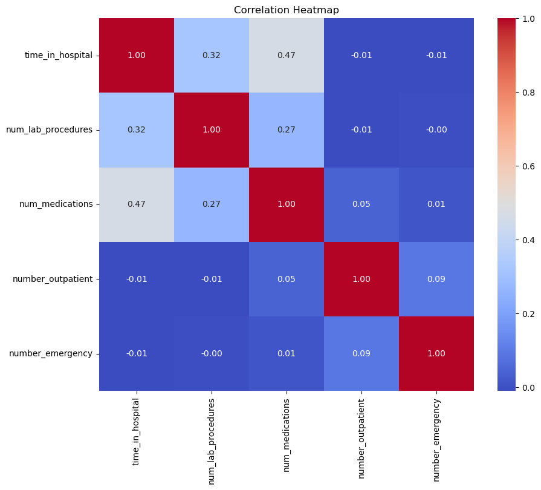
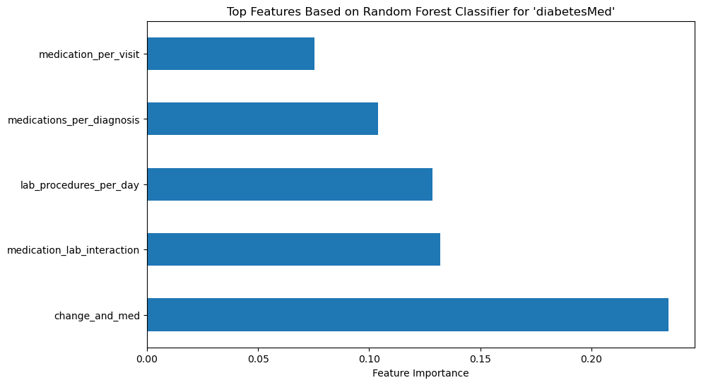
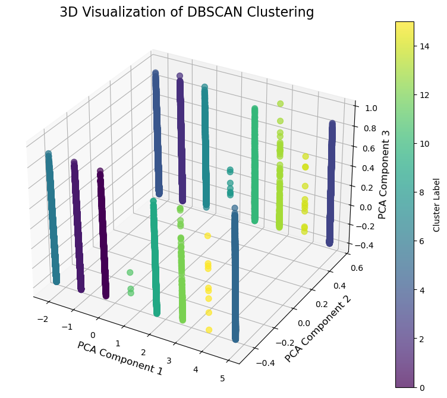

# Diabetes Hospital Analytics

Machine learning on **101,766 hospital encounters of diabetic patients** to predict **how long a patient stays in hospital** and **whether they are prescribed diabetes medication**, plus unsupervised clustering of patient profiles.

**Tech stack:** Python · SQL · pandas · NumPy · scikit-learn · XGBoost · Matplotlib · Seaborn

---

## Problem

Hospitals need to plan beds and treatment. Using patient demographics, admission details, diagnoses, lab procedures and medications, this project tries to answer:

1. **Regression:** how many days will a patient stay in hospital (`time_in_hospital`)?
2. **Classification:** will the patient be on diabetes medication (`diabetesMed`)?
3. **Clustering:** are there natural groups of patients?

## Data

[Diabetes 130-US Hospitals (1999–2008)](https://archive.ics.uci.edu/dataset/296/diabetes+130-us+hospitals+for+years+1999-2008) from the UCI Machine Learning Repository: 101,766 encounters, 50 features.

---

## Approach

| Step | What I did |
|---|---|
| **EDA (SQL)** | Admission types, discharge dispositions, age distribution, average stay and readmission rates per admission type |
| **EDA (Python)** | Distributions, outliers, correlation analysis, missing-value analysis |
| **Cleaning** | Dropped columns with mostly missing values (`weight`, `payer_code`, …), imputed `?` values, mapped ICD-9 diagnosis codes to disease groups, label/one-hot encoding |
| **Modelling** | Linear, Ridge, Lasso, Decision Tree, Gradient Boosting and XGBoost regressors; Logistic Regression, Random Forest and KNN classifiers; K-Means, Agglomerative and DBSCAN clustering |
| **Feature engineering** | Ratios (e.g. `admission_discharge_ratio`), interactions (`medication_lab_interaction`), `total_visits`, `medication_per_visit`; Random-Forest feature importance for selection; IQR outlier handling |
| **Tuning** | GridSearchCV, 5-fold cross-validation and nested cross-validation |



---

## Results

### Regression: hospital length of stay (days)

| Model | MAE | RMSE |
|---|---|---|
| Linear Regression | 1.93 | 2.53 |
| Decision Tree | 1.85 | 2.45 |
| Gradient Boosting | 1.79 | 2.36 |
| **XGBoost** | **1.78** | **2.36** |

*After feature engineering and selection.* Tree-based ensembles beat linear models, and predictions are on average within **~1.8 days** of the true stay.

### Classification: diabetes medication

| Model | Accuracy | Precision | Recall | F1 |
|---|---|---|---|---|
| Logistic Regression | 0.586 | 0.825 | 0.586 | 0.686 |
| KNN | 0.771 | 0.784 | 0.970 | 0.867 |
| **Random Forest** | **0.777** | 0.781 | **0.987** | **0.872** |

*After feature engineering and hyperparameter tuning.*

| Most important features | DBSCAN clusters (PCA, 3D) |
|---|---|
|  |  |

### Clustering

| Method | Silhouette score |
|---|---|
| K-Means (k = 2) | 0.644 |
| Agglomerative (10k sample) | 0.645 |
| **DBSCAN** | **0.780** |

---

## Repository structure

```
diabetes-hospital-ml/
├── diabetes_hospital_analysis.ipynb   # full analysis: EDA → cleaning → models → tuning
├── data/
│   └── cleaned_data.csv               # cleaned dataset (output of the notebook's cleaning step)
├── docs/
│   └── final_report.pdf               # written report with all steps and results
├── extras/                            # ML algorithms implemented from scratch (NumPy)
├── certificates/                      # DataCamp course certificates
└── assets/                            # charts used in this README
```

### Extras: ML from scratch

To understand what scikit-learn does under the hood, I implemented the core algorithms myself with NumPy:

| Notebook | What it covers |
|---|---|
| [`linear_regression_from_scratch.ipynb`](extras/linear_regression_from_scratch.ipynb) | Cost function, gradient descent, L2 regularisation, tuning; compared with scikit-learn |
| [`logistic_regression_from_scratch.ipynb`](extras/logistic_regression_from_scratch.ipynb) | Sigmoid, cross-entropy cost, gradient descent, regularisation, evaluation |
| [`gradient_descent_function_minimisation.ipynb`](extras/gradient_descent_function_minimisation.ipynb) | Minimising a polynomial; effect of learning rate and starting point |
| [`gradient_descent_house_prices.ipynb`](extras/gradient_descent_house_prices.ipynb) | House-price prediction with gradient descent vs. scikit-learn |

### Certificates

Courses I completed alongside this project (DataCamp): [Supervised Learning with scikit-learn](certificates/Supervised%20Learning%20with%20scikit-learn.pdf) · [Machine Learning with Tree-Based Models](certificates/Machine%20Learning%20with%20Tree-Based%20Models%20in%20Python.pdf) · [Hyperparameter Tuning in Python](certificates/Hyperparameter%20Tuning%20in%20Python.pdf) · [Exploratory Data Analysis in Python](certificates/Exploratory%20Data%20Analysis%20in%20Python.pdf) · [Intermediate SQL](certificates/Intermediate%20SQL.pdf) · [Introduction to Statistics in Python](certificates/Introduction%20to%20Statistics%20in%20Python.pdf) · [Writing Efficient Python Code](certificates/Writing%20Efficient%20Python%20Code.pdf) · [Writing Functions in Python](certificates/Writing%20Functions%20in%20Python.pdf) · [Introduction to Functions in Python](certificates/Introduction%20to%20Functions%20in%20Python.pdf) · [Data Types in Python](certificates/Data%20Types%20in%20Python.pdf) · [Introduction to Python](certificates/Introduction%20to%20Python.pdf)

## How to run

```bash
pip install pandas numpy scikit-learn xgboost matplotlib seaborn jupyter
jupyter notebook diabetes_hospital_analysis.ipynb
```

`data/cleaned_data.csv` is included, so the modelling sections run directly.
To re-run the cleaning steps too, download `diabetic_data.csv` from the UCI link above and put it in `data/`.

---

## Reflection: what I would do differently now

- **Compare against a majority-class baseline.** About 77 % of patients are on diabetes medication, so a model that always predicts "yes" already scores ~0.77 accuracy. The very high recall of KNN and Random Forest suggests they lean toward the majority class. Balanced accuracy or ROC-AUC would be fairer metrics.
- **Use pipelines.** Fitting scalers and encoders inside a scikit-learn `Pipeline` would rule out data leakage between train and test sets.
- **Length of stay is hard to predict from these features alone** (R² ≈ 0.27 for linear models), which is an honest finding in itself.

---

Built in Year 1 of the Applied Data Science & AI programme at Breda University of Applied Sciences.
**Author:** Ahmed Ali Alezabi · [GitHub](https://github.com/AhmedAlezabi1)
